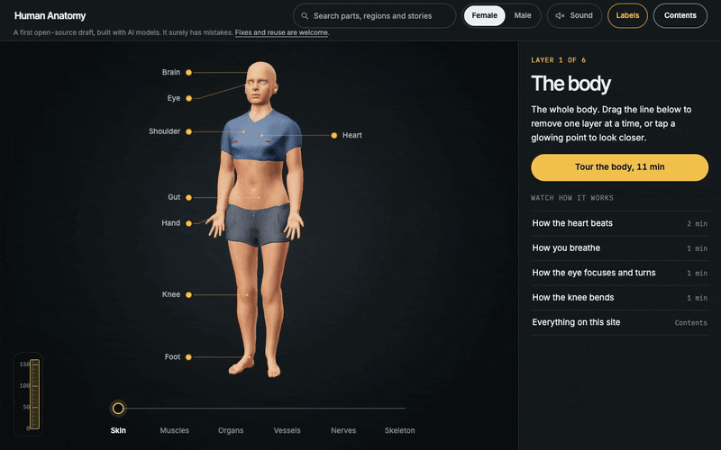
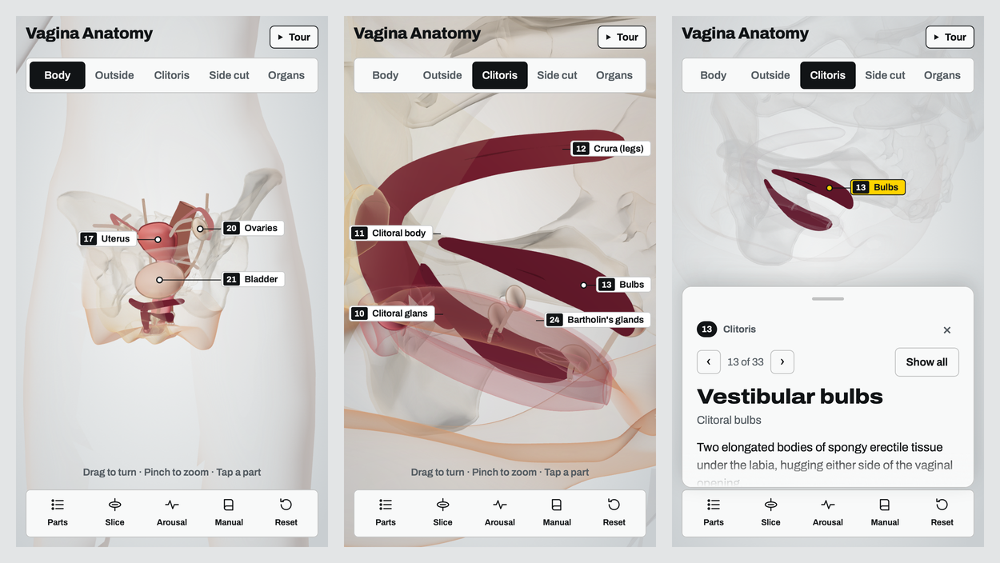

<div align="center">

# Vagina Anatomy

**An interactive 3D model of the vulva, clitoris and pelvic organs.**

[**Open the model →**](https://vagina.wooten-labs.com) &nbsp;·&nbsp; made by [Wooten Labs](https://wooten-labs.com)

[](https://vagina.wooten-labs.com)
[](LICENSE)
[](https://threejs.org)

<a href="https://vagina.wooten-labs.com"></a>

</div>

## What you can do

| | |
|---|---|
| **See it in a body** | Opens on a see-through body with the pelvis inside, so you know where everything sits. Fade the body in or out. |
| **Switch views** | Body, Outside (the vulva), Clitoris (the whole organ, mostly internal), Side cut (a midline section) and All organs. |
| **Explore 33 parts** | Click any numbered callout, or step through them with ‹ › or the arrow keys. Each part has a description, a common misconception, published measurements and its male equivalent. |
| **Slice across** | Cut across the vagina at any depth to see its H-shaped, front-to-back flattened cross-section. |
| **Arousal** | Drag the slider to watch the clitoris and bulbs swell, the inner vagina lengthen and balloon, and the uterus lift, following Masters & Johnson. |
| **Guided tour** | An automatic walk through every part, outside in, with Back, Pause and Next. |

It works on phones too: the tools move to a bottom bar, details open in a sheet, and you turn the model with one finger and pinch to zoom.

<div align="center">

</div>

## How accurate is it?

Sizes and angles are checked by automated tests against published ranges (the `anatomy` tests in [`tests/manual.spec.mjs`](tests/manual.spec.mjs)). Main sources:

- **Longhurst et al., *Clinical Anatomy* 2023:** clitoris meta-analysis of 21 studies.
- **Lloyd et al., *BJOG* 2005:** vulval and vaginal ranges.
- **MRI studies** of vaginal and uterine angles.
- **NIH Human Reference Atlas** (Visible Human Female): the bony pelvis is used directly. The ovaries, fallopian tubes, rectum and uterine ligaments were positioned and checked against it, and tests confirm no organ passes through bone.

It's an educational model, simplified for clarity. Bodies vary widely, and it isn't medical advice. Spotted something wrong? Please [open an issue](https://github.com/jonclegg/vagina-anatomy/issues).

## How it's built

The whole app is one static page, [`site/index.html`](site/index.html), using [three.js](https://threejs.org) with no build step.

- **Built in code:** most of the anatomy (vulva, clitoris, vagina, uterus, bladder and so on) is generated from measured dimensions, so arousal can reshape it live.
- **Embedded meshes:** the pelvis comes from the NIH Human Reference Atlas, and the body outline is a slim young adult woman built from [MakeHuman](https://github.com/makehumancommunity/makehuman). Both are simplified, compressed and embedded in the page.
- **Rendering:** ink outlines like a technical drawing, an X-ray mode that fades parts to their silhouettes, and isolation that keeps a chosen part solid with everything else as context.

## Run it locally

```bash
npm install
npx playwright install webkit chromium
npm run serve        # http://127.0.0.1:4173
npm test             # Playwright: desktop Safari, desktop Chrome and iPhone
```

### Scripts

| Script | What it does |
|---|---|
| `scripts/build-pelvis.mjs <HRA_bony_pelvis_female_VHF.glb>` | Rebuilds the embedded pelvis from the [Human Reference Atlas](https://humanatlas.io) female bony pelvis, aligned to the model in [`hra-frame.mjs`](scripts/hra-frame.mjs). |
| `scripts/build-body.mjs <folder>` | Rebuilds the body outline from the MakeHuman base mesh and morph targets (the folder needs `base.obj` and the targets listed in the script). |
| `scripts/export-standalone.mjs <out.html>` | Writes the page as deployed on [wooten-labs.com](https://wooten-labs.com). |
| `scripts/ui-review.mjs <round>` | Screenshots the page and asks several AI models to score the design against benchmark sites (needs `OPENROUTER_API_KEY`). Each round's scores and comments are in [`design-review/`](design-review/). |

## Human Anatomy: the whole body

[`site/body/`](site/body/) is a second, larger model: the whole human body, male and female, at the same standard. It has the skeleton, the muscles, the organs, the vessels, the nervous system and the skin, about 3,000 named structures in each body. The model above stays as the detailed close-up of the female pelvis.

| | |
|---|---|
| **Male and female** | Switch bodies at the top right. A selected part carries over, or jumps to its equivalent (testes and ovaries). |
| **Views per system** | Body, Skeleton, Muscles, Organs, Vessels and Nerves, each with the rest as faint context. |
| **Every structure** | Every structure can be picked on the model, found by name in the parts list, and isolated. 188 main parts have a description, a common misconception, published measurements and the other sex's equivalent. Step through them with ‹ › or the arrow keys. |
| **Clothed by default** | Both bodies open with the skin solid and clothes on (a short top and shorts, boxer briefs), as a safe-for-work first view. The Clothing switch takes it off; in the system views it fades with the skin but still covers. |
| **X-ray and skin** | Fade a view's outer layer to outlines, and fade the skin. |
| **Loads fast** | Each system is its own compressed GLB (meshopt), fetched only when a view needs it. The opening view loads 2–3 MB. |

### Where the shapes come from

- **Male:** one adult man from [BodyParts3D](https://dbarchive.biosciencedbc.jp/en/bodyparts3d/) (2,234 structures, built from CT and MRI). BodyParts3D has no lungs and no spinal cord, so those come from the NIH Visible Human Male, carried into the BodyParts3D body by the fit described below.
- **Added from [Z-Anatomy](https://github.com/Z-Anatomy/Models-of-human-anatomy):** about 750 structures BodyParts3D lacks: the muscles of the face, jaw, back and abdominal wall (latissimus dorsi, rectus abdominis, masseter, temporalis and others), the tendon sheets of the scalp and palm, the middle and lower pharynx, the parathyroid glands, ligaments and joint capsules, the peripheral and cranial nerves, lymph nodes, the thyroid gland, and many vessels. Z-Anatomy is built on BodyParts3D but remodelled, so it is aligned to the BodyParts3D bones: every bone the two have in common (about 180, down to the bones of the face, fingers and toes) pins the fit, so the face muscles follow the facial bones and the toe ligaments the toes. A Z-Anatomy structure is kept only where BodyParts3D has nothing of the same name or in the same place, a structure kept on one side only gets its twin by mirroring (Z-Anatomy's left side is its right side mirrored; not the organs of the chest and belly, which are one-sided by nature), its orbicularis oris, modelled as a ring around an open mouth, has its lips closed, and whatever still lies a little outside his skin is brought under it with the layers beneath ([`scripts/body/zanatomy.mjs`](scripts/body/zanatomy.mjs), [`scripts/body/build-male.mjs`](scripts/body/build-male.mjs)). Its non-commercial parts (the inner ear, a kidney) and its brain models with no stated licence are never exported.
- **Female, fitted:** no free model of a whole female body exists; scans of women give organs, but no skeleton or muscles that belong with them. So her body is the male body, reshaped as a whole onto a slim young woman's skin (below). In the app, each part that came this way says *Fitted* in its details.
- **Female, modelled:** her skin is [MakeHuman](https://github.com/makehumancommunity/makehuman)'s base mesh with its young Caucasian female and low-weight shape targets (CC0).
- **Female, scanned:** what is hers alone: her uterus, vagina, ovaries, tubes and their ligaments, and her breasts, from the NIH Visible Human Female ([Human Reference Atlas](https://humanatlas.io/3d-reference-library)), fitted into her pelvis and under her skin. The man's own reproductive organs are left out.

How the male's lungs and spinal cord are carried in ([`scripts/body/register.mjs`](scripts/body/register.mjs)): matching structures of the Visible Human Male and the BodyParts3D man (hip bones, femurs, tibias, kneecaps, heart, liver, kidneys, trachea, larynx) are aligned one by one with affine ICP, and the spine disc by disc. A thin-plate spline through all of those points carries the rest across; near a matched structure, soft tissue moves with that structure's own fit.

How the female body is made ([`scripts/body/transfer.mjs`](scripts/body/transfer.mjs), [`scripts/body/makehuman.mjs`](scripts/body/makehuman.mjs)). The male body is one man, so his skin, bones, muscles and organs fit each other. The method keeps that fit by never moving one part against another:

1. MakeHuman, in a male shape, is posed to his skeleton with its own skin weights, then drawn onto his skin: each vertex moves to the nearest skin point that faces the same way, as a sheet that resists stretching, so it keeps its layout. Every MakeHuman vertex now marks a known spot on him.
2. The same mesh in its female shape is put through the same pose, each limb hinged at its own joints. Her skin is his skin plus the difference between the two posed shapes, so flaws of the pose, which both share, cancel. Her head, hands and feet are MakeHuman's own, and her lips are closed.
3. One smooth thin-plate spline takes each marked spot on his skin to the same vertex of hers (the breasts are left out, so the chest wall does not swell into them), his eyes to her eyes, and his hand and foot joints to hers. Everything inside him follows it. The pose does not change, so nothing has to turn or tear.
4. Each hand and foot then gets its own exact fit, bone end onto joint. The joints of a hand lie nearly in one plane, so each is also paired a little above and below that plane, which keeps the bones their thickness. Her finger and toe skin rises over the bones where MakeHuman's slender digits would not hold them. Each eyeball is set in her eyelids, and the muscles and nerve fixed to it go with it.
5. Whatever still lies outside the skin or just under it is brought under: the layers there are pressed inward together, so a sheet of muscle stays over its bone. The man's own data has some of this (a vein, a band of fascia and some toe ligaments from Z-Anatomy run over his skin).
6. The body is scaled to 163 cm. Her scanned pelvic organs are fitted by matching the scan's hip bones, sacrum, bladder and rectum to hers; each scanned breast is fitted into the breast of her skin, nipple under nipple and back on the chest wall.

### Checking the anatomy

BodyParts3D itself has a few structures twice under two names (the celiac trunk as "Celiac artery", the pancreas as its "Parenchyma", the anal sphincter as a perineal muscle): the copies are left out ([`scripts/body/build-male.mjs`](scripts/body/build-male.mjs)).

`node scripts/body/audit.mjs <female|male> [layer]` audits a built body: structures with no twin on the other side, left and right twins that differ in size or place, muscles that float clear of every bone, and structures drawn twice in the same place. The platysma, a paper-thin sheet in the skin of the neck, is drawn only when chosen, so the sternocleidomastoid and the throat muscles under it show, as atlases draw the neck.

### What is missing

The inner ear (the only free model is non-commercial), the pericardium and the other membranes that line the body's cavities, and the smallest vessels and nerves. The caecum and the sigmoid colon are not parts of their own (the ascending and descending colon run on through them). The middle cardiac vein and the artery beside it share one shape in the source, and so do the superficial and superior epigastric veins. No one has checked each muscle's attachments against a reference: the audit checks that muscles are present, paired, on bone and not doubled. The female body is the male one reshaped, apart from her scanned reproductive organs and breasts, and it has no hair (MakeHuman's hair is not in its public repository).

### Checks

`npm run test:body` runs Playwright on desktop Safari, desktop Chrome and an iPhone. It covers loading, every view, both bodies, picking, isolation, stepping, X-ray, the phone layout, and anatomy. The anatomy tests measure each body's bones and organs (height, femur, humerus, tibia, kidney, heart, spleen, trachea, spinal cord, pelvic width, uterus) against published adult ranges, check that no major organ passes through bone and that bone and muscle stay inside the skin, and that the female waist is a slim one. The clothing tests check both bodies open clothed and solid.

### Rebuilding the data

```bash
node scripts/body/build-male.mjs "<Human Anatomy 3D Models folder>"
```

```bash
node scripts/body/build-female.mjs "<Human Anatomy 3D Models folder>" "<female-reproductive-3d-models folder>"
```

The female build reads the built male body (`site/body/data/male/`), so the male comes first; it takes about a minute and writes `site/body/data/female/`. `node scripts/body/review.mjs <female|male>` then writes contact sheets of every view to `build/review/<sex>/`, and `node scripts/body/shots.mjs` close-ups from any angle (both with the site served).

The MakeHuman files are read from `MakeHuman (CC0)` inside the models folder. They come from [makehumancommunity/makehuman](https://github.com/makehumancommunity/makehuman/tree/master/makehuman/data): `3dobjs/base.obj`, `rigs/default.mhskel`, `rigs/default_weights.mhw`, and from `targets/macrodetails/` the targets named in [`scripts/body/build-female.mjs`](scripts/body/build-female.mjs), all in one folder.

She is dressed by her own build, in MakeHuman's clothing (CC0): the top of its `female_sportsuit01` and the shorts of its `female_casualsuit02`, read from `MakeHuman clothes (CC0)/clothes` inside the models folder (the `makehuman_system_assets_cc0` pack from [files.makehumancommunity.org](https://files.makehumancommunity.org/asset_packs/makehuman_system_assets/)). A MakeHuman garment is tied vertex by vertex to the MakeHuman body mesh, which her skin is, so it follows her shape ([`scripts/body/garments.mjs`](scripts/body/garments.mjs)). His briefs are shaped from his skin:

```bash
node scripts/body/clothing.mjs male
```

First export Z-Anatomy with Blender (the scripts in [`scripts/body/blender/`](scripts/body/blender/) write to the folder the builds read):

```bash
blender -b --disable-autoexec "<Z-Anatomy folder>/Startup.blend" --python scripts/body/blender/export-zanatomy.py -- "<Human Anatomy 3D Models folder>/Whole Body - Z-Anatomy (Blender)/export/zanatomy.glb"
```

```bash
blender -b --disable-autoexec "<Z-Anatomy folder>/Startup.blend" --python scripts/body/blender/export-zanatomy-bones.py -- "<Human Anatomy 3D Models folder>/Whole Body - Z-Anatomy (Blender)/export/zanatomy-bones.glb"
```

The male build takes a few minutes. The builds write `site/body/data/<sex>/` (one GLB per layer, `parts.json`, and `clothing.glb`). The text for each main part is in [`site/body/parts.mjs`](site/body/parts.mjs). Serve the site with `npm run serve:body` (http://127.0.0.1:4174).

## Licence

Code and text are [MIT](LICENSE). Embedded data keeps its own licence: the pelvis is from the NIH Human Reference Atlas (CC BY 4.0), and the body outline is from MakeHuman (CC0).

The whole-body data in `site/body/data/` is derived from:

- **BodyParts3D**, © The Database Center for Life Science, licensed under CC Attribution 4.0 International ([licence page](https://dbarchive.biosciencedbc.jp/en/bodyparts3d/lic.html)). The OBJ files' headers still carry an older CC BY-SA 2.1 Japan notice; the licence page, updated 27 February 2025, gives CC BY 4.0. Simplified, re-coloured and, for the female body, reshaped.
- **Human Reference Atlas 3D reference organs** (HuBMAP, NIH; Visible Human Project, U.S. National Library of Medicine; brain from the Allen Institute), CC BY 4.0. Simplified, renamed and aligned.
- **MakeHuman** base mesh, skeleton, skin weights and shape targets (the female skin), and two garments (the female clothing), CC0.
- **Z-Anatomy**, the libre 3D atlas of anatomy, CC BY-SA 4.0 (built on BodyParts3D); cranial nerves after Cranial Nerves and Foramina, University of Dundee CAHID, CC BY 4.0. Aligned, simplified and, for the female body, reshaped.

Because it includes Z-Anatomy, the whole-body 3D data (`site/body/data/`) is shared under [CC BY-SA 4.0](https://creativecommons.org/licenses/by-sa/4.0/). The code and the text in `site/body/parts.mjs` stay MIT.

<div align="center"><sub>A <a href="https://wooten-labs.com">Wooten Labs</a> project.</sub></div>
