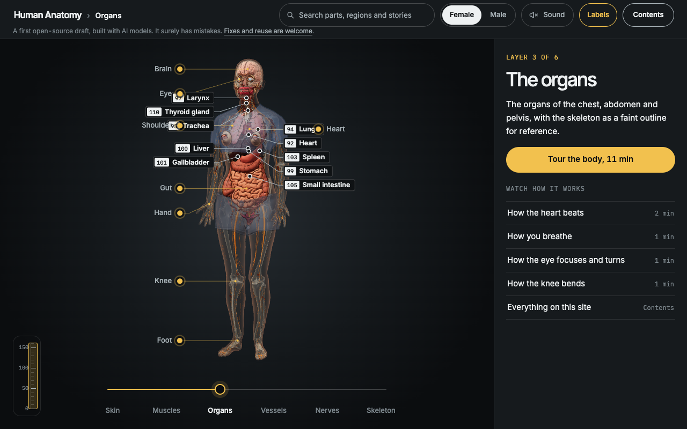
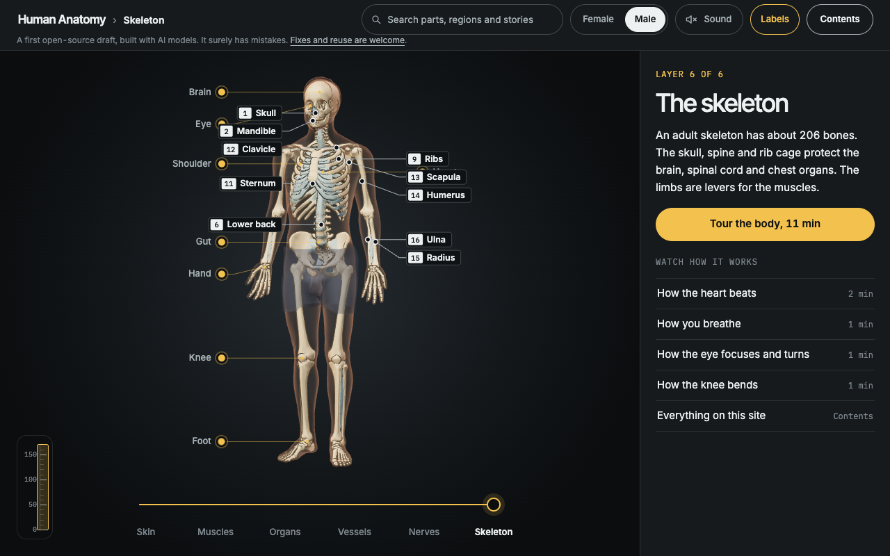
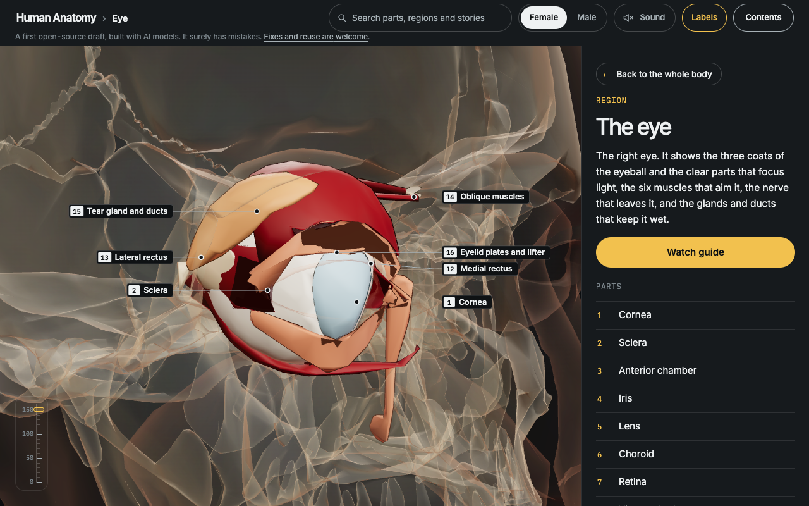
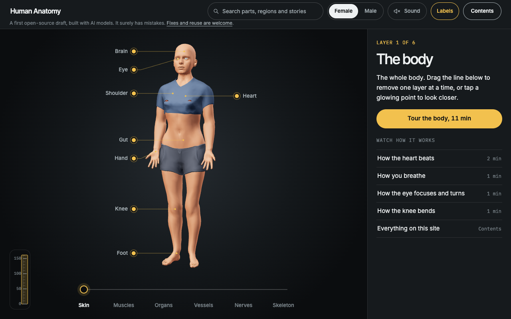

<div align="center">

# Human Anatomy

**The whole human body in 3D, male and female, in your browser.**

[**Open it: anatomy.wooten-labs.com →**](https://anatomy.wooten-labs.com)

<a href="https://anatomy.wooten-labs.com"></a>

</div>

## Try it

- **Peel the body.** Drag the line under the body from skin to muscles, organs, vessels, nerves and bones.
- **Look closer.** Tap a glowing point (brain, eye, heart, shoulder, gut, hand, knee, foot) to open that region with its numbered parts.
- **Watch how it works.** Stories show the heart beating, breathing, the eye focusing and the knee bending, a step at a time, told aloud.
- **Switch bodies.** Female and Male at the top. A part you have open carries over to the other body.
- **Find anything.** Search by name or everyday name ("thigh bone", "voice box"). Each body has about 3,000 named structures, and any of them can be picked and isolated; 188 main parts have notes and measurements.

| | |
|---|---|
|  |  |
|  |  |

<p align="center"></p>

## What it is

An interactive anatomy model of an adult man and an adult woman: skeleton, muscles, organs, vessels, nerves and skin. The shapes come from published, openly licensed 3D data: [BodyParts3D](https://dbarchive.biosciencedbc.jp/en/bodyparts3d/), [Z-Anatomy](https://github.com/Z-Anatomy/Models-of-human-anatomy), the NIH Visible Human scans and [MakeHuman](https://github.com/makehumancommunity/makehuman). Her vulva, clitoris and urethra are built in code from published measurements. It runs in the browser with three.js, on desktop and phone.

**It is a first draft, built largely with AI models, and it has mistakes.** Shapes, positions, names and notes can be wrong. It is not medical advice, and nobody with medical training has reviewed it.

How it is made, how it is checked and how to rebuild the data: [docs/how-it-is-made.md](docs/how-it-is-made.md).

## Help fix it

Every part in the app has a "Suggest a fix on GitHub" link, which opens an issue with the part's name filled in. Or [open an issue](https://github.com/jonclegg/human-anatomy/issues) directly: say what is wrong and what is right, with a source if you have one. Pull requests are welcome.

```bash
npm install
npx playwright install webkit chromium
npm run serve:body   # http://127.0.0.1:4174
npm run test:body
```

## Licence

Code and text are [MIT](LICENSE). The 3D data in `site/body/data/` is [CC BY-SA 4.0](https://creativecommons.org/licenses/by-sa/4.0/), because it includes Z-Anatomy. It is derived from:

- **BodyParts3D**, © The Database Center for Life Science, CC BY 4.0 ([licence page](https://dbarchive.biosciencedbc.jp/en/bodyparts3d/lic.html)). Simplified, re-coloured and, for the female body, reshaped.
- **Human Reference Atlas 3D reference organs** (HuBMAP, NIH; Visible Human Project, U.S. National Library of Medicine; brain from the Allen Institute), CC BY 4.0. Simplified, renamed and aligned.
- **MakeHuman** base mesh, skeleton, skin weights, shape targets and three garments, CC0.
- **Z-Anatomy**, CC BY-SA 4.0 (built on BodyParts3D); cranial nerves after Cranial Nerves and Foramina, University of Dundee CAHID, CC BY 4.0. Aligned, simplified and, for the female body, reshaped.

<div align="center"><sub>A <a href="https://wooten-labs.com">Wooten Labs</a> project.</sub></div>
